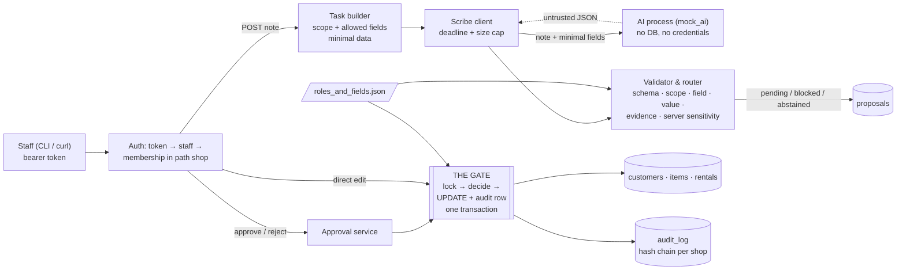

# Safe Counter: Design (Level 0)

Written before any code. The "What changed and why" section at the end is added at the end; this part is not rewritten.

## Main parts

| Part | Responsibility |
| --- | --- |
| **API** (Python, FastAPI, raw SQL via psycopg) | HTTP endpoints. Resolves a bearer token to a seeded staff member and checks they hold a membership in the shop named in the path (`/shops/{shop_id}/...`). One shop per request. |
| **Rules** (`data/roles_and_fields.json`) | Read-only server config loaded at startup. Field formats, limits, who may change, who approves, value rules (write-off). Never sent to or writable by the AI. |
| **Task builder** | Turns a note into an AI task: the note's scope records (checked to belong to the shop), only the fields the task needs, and the allowed fields = fields the AI may propose AND the note author's role may change. |
| **Scribe client** | Calls the AI over HTTP with a total deadline and a response size cap. Never holds a DB transaction open while waiting. |
| **Validator and router** | Treats AI output as hostile input. Checks shape, task id, scope, field allowlist, value rules, verbatim evidence; derives sensitivity on the server. Each proposal becomes `pending`, `blocked` (with reason) or an abstention. |
| **Approval service** | Approve, reject, or edit-then-approve a pending proposal. Records who, when, why, the AI's value and the final value. |
| **The gate** `apply_change()` | The only code that writes business tables. Locks the row, validates the value, derives sensitivity, checks the actor's role in that shop, decides apply-now or wait, then writes the change and its audit row in one transaction. |
| **Audit chain** | Append-only `audit_log`, one hash chain per shop; `verify` reports the first broken row. |
| **Postgres** | Business tables, proposals, audit. Second line of defence: RLS, column-level grants, CHECK constraints, composite shop foreign keys. |

## How a note becomes an applied change

1. A staff member posts a note with its scope. The note is stored; an `ai_task` row records the prompt version and rules hash.
2. Outside any transaction, the scribe client sends the AI the note and only the needed fields. Timeout, connection drop, 5xx, invalid JSON or wrong shape: the task is marked failed, no proposals are stored, no business row changes, the caller gets a clear error.
3. The router checks each proposal on its own. Anything outside the task's records, shop or allowed fields, any extra key (such as `approved_by`), any bad value, or evidence not found word for word in the note is stored as `blocked` with a reason and can never be approved. The AI's sensitivity label is stored but ignored.
4. A valid proposal is stored as `pending` with the server-derived approver roles. Confidence only adds a `low_confidence` flag; it never relaxes who may approve.
5. An approver approves (optionally correcting the value). In one transaction the proposal row is locked (a second approver waits, then gets "already approved by X"), the gate re-checks everything with the final value, updates the record, appends the audit row, and marks the proposal approved. A rejection is terminal.
6. A person's direct edit goes straight to the gate: applies now (normal field, or they are an approver for the sensitive field), waits as a human proposal (sensitive, not an approver), or is refused (role may not change the field). Nobody approves their own pending change.

## Where shop isolation is enforced

- **API:** every route is under one shop; the actor must be a member of it; every query filters `shop_id` as well as `id`.
- **Database:** the app connects as a non-owner role without BYPASSRLS. Row-level security on every shop table checks `current_setting('app.shop_id')`, set with `SET LOCAL` per transaction (unset means no rows). The app role can update only the eleven changeable columns, cannot insert or delete business rows, and can only insert and read audit rows. Composite foreign keys on `(shop_id, id)` stop a rental pointing at another shop's customer or item.

## Where the AI runs and what it can reach

The AI is a separate process (the supplied mock, or a compatible model) reached over HTTP. It has no database credentials and no credential to our API: its only output channel is the HTTP response, which we parse as untrusted. It receives one note and the minimum fields for that task (never `id_check_ref`, no contact details unless a customer is in scope). It cannot see or change its prompt, the rules, or approval settings; there is no endpoint for any of those.

## The three failures that worry me most

1. **An unauthorized change is applied**: hostile or mislabelled AI output, a scope escape, or a code path that skips the gate. Answered by one gate, server-derived sensitivity, allowlists, and database grants, RLS and CHECKs underneath. Known gap: the app role can still update the changeable columns directly, so a bug outside the gate could skip policy checks.
2. **A plausible but wrong proposal is approved by a person**: a charge on the wrong rental (N04), an attacker's email from pasted text (N08). No rule catches every semantic error. Answered by verbatim evidence checks, evidence-value agreement for money, flags, before→after values and a required reason. This is the residual risk, and I will say so.
3. **Integrity under concurrency or failure**: two approvals at once, a change without its audit row, a forked audit chain, a shop setting leaking through a pooled connection, partial state after an AI timeout. Answered by row locks, one transaction per change, a locked per-shop chain head with unique `(shop_id, seq)`, `SET LOCAL` only, and no transaction open during the AI call. Limitation: a hash chain detects edits but anyone with database write access can recompute it from the edited row onward; stopping that needs an anchor outside the database.

## What changed and why

Added at the end of the build. The design above is unchanged; this section records where the build went further, changed course, or stopped short. Decision numbers refer to `docs/decisions.md`.

**Built as designed:** one gate, server-derived sensitivity, per-proposal routing, the AI as a separate process with no database access or credentials, the restricted app role with RLS and column-level grants, per-shop hash chains with a locked head, synchronous AI call with no transaction open.

**Added during the build**
- **Database-enforced proposal lifecycle.** A trigger allows proposals to be created only as pending or blocked, lets only pending ones change, requires who, when and why, and refuses a decision by the requester (R4), so rule R5 holds even for a direct SQL update by the app role.
- **Stale-proposal check (D20).** Each proposal stores the value it was based on; approval is refused if the record changed since. Needed because AI values such as hire_days are derived from the current value.
- **Evidence must agree with the value (D21).** A verbatim quote is not enough: money amounts, clock times and phone digits in the evidence must match the value, and any non-GBP currency blocks. This is what catches N04's 12000p from "120 euros", which the range check alone lets through.
- **Edit-before-approve re-derives sensitivity** from the corrected value, so correcting "available" to "retired" turns it into a write-off that only an area admin can approve.

**Changed**
- **Times are stored as ISO text with offset (D17),** not `timestamptz`, because the brief asks to keep the offset and the audit hash must cover exactly what is stored.
- **Failed AI calls keep the note and a failed task row (D19).** "Nothing saved" is read as no proposals and no business changes.
- **Rejection needs the same authority as approval (D18).**

**What the three failures turned into**
1. *Unauthorised change:* tested by role, value-rule, scope, hostile-output and privilege tests, plus a source scan that only the gate writes business tables. Still open: the gate is enforced by code structure, not by the database alone (D02).
2. *Plausible but wrong proposal approved:* the router blocked all 4 of the mock's wrong proposals, at the cost of 1 false block (N05's paraphrased refund). Still open, and the main residual risk: a semantically wrong proposal that passes every rule reaches a person.
3. *Integrity under concurrency or failure:* tested by the threaded double-approval test (15 of 15 repeated runs), audit rollback with the change, tamper/delete/truncate detection, and every mock failure mode. Still open: a database owner can rewrite the chain; there is no external anchor.

**Not done:** the scribe as a separate worker holding a per-task token (D03), the gate as a database function (D02), external anchoring of audit heads, and any measurement of the prompt against a real model.

**Level 3, added after the submission essentials**
- **A real model behind the same door (D23, D24, D26).** Groq `openai/gpt-oss-120b` is an optional second provider. Its reply enters at the same point as the mock's and passes the same shape check, router, approval rules, gate, grants and audit; nothing else in the flow changed. The experiment chose few-shot over zero-shot and kept the verbatim-evidence rule, and it measured failure 2 directly: the same three wrong-but-valid proposals reached a person in every real run.
- **Reliable event delivery (D25).** The gate now also writes an outbox row in the change's transaction; a worker with its own minimal role delivers it with retries and an idempotency key. At-least-once, not exactly-once.
